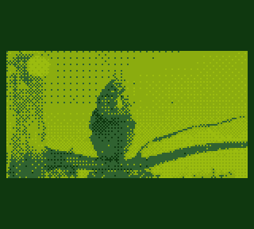
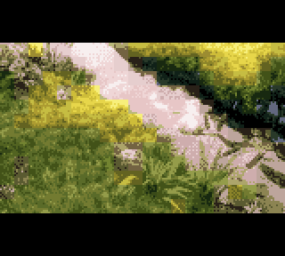
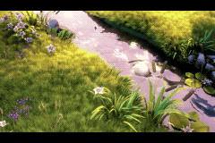
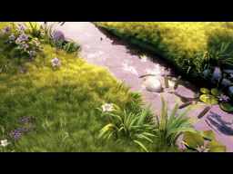
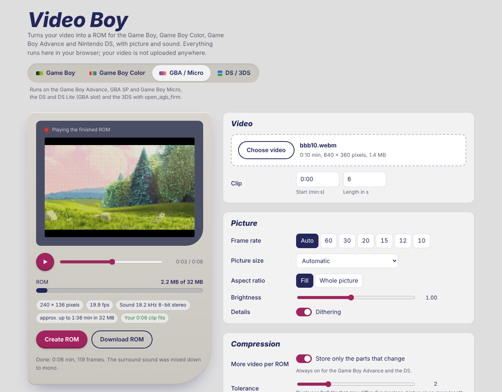

# VIDEO BOY: Video Player for Game Boy, Game Boy Color, Game Boy Advance and Nintendo DS

VIDEO BOY turns any video file (mp4, mkv, mov, webm …) into a ROM with **picture and stereo sound**
for Nintendo handhelds:

| Target | File | Picture | Sound | Runs on |
|---|---|---|---|---|
| Game Boy | `.gb` | up to 152×80, 4 shades | 9.2 kHz, 3-bit | Game Boy, Pocket, Color, Advance, GBA SP |
| Game Boy Color | `.gbc` | up to 160×144, 32 colours | 18.4 kHz, 3-bit | Game Boy Color, Advance, GBA SP |
| Game Boy Advance | `.gba` | up to 240×160, 256 colours | 18.2 kHz, 8-bit | GBA, GBA SP, **Game Boy Micro**, **DS / DS Lite** (GBA slot), **3DS** (open_agb_firm) |
| Nintendo DS | `.nds` | up to 256×192, 256 colours | 21.2 kHz, 8-bit | **DS, DS Lite, DSi, 3DS / 2DS** (flash cart or TWiLight Menu++) |

The [browser app](#browser-app-no-installation) builds all four. The command-line tool `videoboy.py`
builds Game Boy and Game Boy Color ROMs (see [Game Boy Color mode](#game-boy-color-mode---gbc)).

| Game Boy | Game Boy Color | Game Boy Advance | Nintendo DS (top screen) |
|---|---|---|---|
|  |  |  |  |

*Captured from the emulators SameBoy (Game Boy, Game Boy Color, colour correction off), mGBA and melonDS.
Footage: "Big Buck Bunny", see credits below.*

## Requirements

For the command-line tool you need the following. The [browser app](#browser-app-no-installation) needs nothing but a browser.

* Python 3.8+ with `numpy` (`pip install numpy`)
* `ffmpeg` and `ffprobe` in your PATH (on Windows, placing `ffmpeg.exe` and `ffprobe.exe`
  next to `videoboy.py` works too)
* For real hardware: a flash cart with **MBC5** support, e.g. EverDrive GB X series, EZ-Flash Junior
  or an 8 MB MBC5 repro flash cart. Long videos need a cart that takes 8 MB ROMs.

## Browser app (no installation)

`web/index.html` is the same converter as a single web page: drop in a video, choose the settings, watch the
Game Boy screen while it converts, play the finished ROM with sound and download it. Everything runs locally in
the browser; the video is not uploaded anywhere, and Python or ffmpeg are not needed.



* Open `web/index.html` in Chrome, Edge or Firefox (double-click is enough), or host it with GitHub Pages.
* All four targets (Game Boy, Game Boy Color, Game Boy Advance / Micro, Nintendo DS / 3DS), a live estimate of
  how much fits, and for Game Boy and Game Boy Color the matching `videoboy.py` command.
* The preview decodes the finished ROM itself, so what you see and hear is exactly what the Game Boy will show.
* Game Boy ROMs are byte-identical to the ones `videoboy.py` builds from the same frames. The audio filters are
  re-created with the Web Audio API, so the sound differs slightly from the command-line tool.
* Surround audio (5.1) is mixed down to mono, because browsers deliver the channels in a container-specific order.
* The browser plays the video internally while converting: keep the tab in the foreground.
* Video formats: whatever the browser can play (MP4/H.264 and WebM in all major browsers).

The app is built from `web/src/` with `python3 web/build.py` (also run by `src/build.sh`).

## Usage

```sh
python3 videoboy.py movie.mp4                         # -> movie.gb
python3 videoboy.py movie.mp4 -o clip.gb --start 1:20 --duration 45
python3 videoboy.py movie.mp4 --fps 30                # smoother, but a smaller picture
python3 videoboy.py movie.mp4 --compress              # compression mode: much more video per ROM
python3 videoboy.py movie.mp4 --gbc --compress        # Game Boy Color ROM in colour -> movie.gbc
python3 videoboy.py movie.mp4 --preview preview.mp4   # see and hear the result before flashing
```

| Option | Meaning |
|---|---|
| `--fps auto/60/30/20/15/12/10` | Frame rate. `auto` = 20 fps, lowered automatically for long videos |
| `--size 144x80` | Picture size in pixels (multiples of 8, max. 191 tiles) |
| `--fit` | Show the whole picture with black borders instead of cropping |
| `--start`, `--duration` | Convert only a part of the video |
| `--gamma 0.8` | Brighter (< 1) or darker (> 1) |
| `--no-contrast`, `--no-dither` | Disable automatic contrast or dithering |
| `--volume 1.5` | Louder (with soft limiting) |
| `--mono` | Mono instead of stereo sound |
| `--no-audio` | No sound |
| `--title NAME` | ROM title in the cartridge header |
| `--preview file.mp4` | Preview video in green DMG look, with sound |
| `--gbc` | **Game Boy Color** ROM in colour (see below) |
| `--compress` | **Compression mode**: much longer videos per ROM (see below) |
| `--tolerance 2` | Only with `--compress`: how many pixels per 8×8 tile may differ before the tile is resent (0 = lossless) |

The messages of the command-line tool are in German; the browser app is in English.

**On the Game Boy:** START = pause, SELECT = restart. At the end, the video loops.

`demo.gb` is a ready-to-play demo ROM (Game of Life animation with a melody).
`demo_color.gbc` is a 15-second colour demo for the Game Boy Color (Big Buck Bunny).

## What the Game Boy can do

Normal mode, 16:9 video:

| fps | Picture size | Max. length in 8 MB |
|---|---|---|
| 60 | 96×48 | ~1:40 min |
| 30 | 128×80 | ~1:25 min |
| 20 | 152×80 | ~1:40 min |
| 15 | 152×80 | ~2:15 min |
| 12 | 152×80 | ~2:50 min |
| 10 | 152×80 | ~3:25 min |

If the video is too long, `--fps auto` lowers the frame rate down to 10 fps. If it still doesn't fit,
the video is cut (with a notice). Use `--compress`, a lower `--fps` or `--start/--duration` for longer material.

The Game Boy cannot read the flash cart's SD card while a ROM is running, so a longer film has to be split
into several ROMs that you start one after another from the cart's menu.

## Compression mode (`--compress`)

```sh
python3 videoboy.py movie.mp4 --compress
python3 videoboy.py movie.mp4 --compress --tolerance 4 --fps 15   # even longer
```

Instead of storing every frame completely, the ROM only contains the 8×8 tiles that changed since the
last frame in the same buffer. The player writes just these tiles to VRAM; everything else stays on screen.

* **How much more fits?** That depends on the material. Calm scenes (dialogue, landscapes, cartoons with a still
  background) compress very well, fast cuts and camera pans hardly at all.
  Measured with "Big Buck Bunny": **2.4×** less memory at 20 fps; a 6-minute sequence with many cuts at 10 fps
  needed 1.6× less, i.e. over 5 minutes in 8 MB instead of 3:25.
* **`--tolerance`** (default 2): a tile in which at most this many pixels changed is not resent. This saves a
  lot, because dithering makes single pixels flip all the time in real video. Errors do not accumulate, because the
  converter tracks exactly what the Game Boy is showing. `0` is lossless; higher values (4–6) give more length but
  occasional "stuck" pixels.
* With `--fps auto`, the converter compresses first and only lowers the frame rate if the result does not fit.
* Sound is not compressed (9198 Hz, 3-bit stereo), so it takes up a larger share of the ROM in this mode.
* The maximum picture size at 30 and 60 fps is slightly smaller than in normal mode (150 and 75 tiles).
* `--preview` shows exactly the compressed result.

## Game Boy Color mode (`--gbc`)

```sh
python3 videoboy.py movie.mp4 --gbc                    # -> movie.gbc
python3 videoboy.py movie.mp4 --gbc --compress         # recommended: about 2x more video
python3 videoboy.py movie.mp4 --gbc --size 160x144     # full screen (crops 16:9 material)
```

The ROM is for the Game Boy Color only (also runs on the Game Boy Advance). All other options work as in the
DMG mode (`--fps`, `--size`, `--fit`, `--compress`, `--tolerance`, `--mono`, `--preview` …).

* **Colour:** every frame gets 8 palettes of 4 colours each, chosen from the 32,768 colours of the GBC, and every
  8×8 tile uses one of them, so up to 32 colours are visible at once. The converter picks the palettes per frame
  with k-means clustering, keeps them stable from frame to frame (no colour flicker, better compression) and
  dithers between the two closest colours of each tile's palette.
* **Bigger picture:** the GBC runs in double speed (8 MHz) and copies 16 bytes per scanline instead of 8.
  The second VRAM bank holds two full-screen buffers, so full screen (160×144) is possible at 20 fps.
* **Better sound:** 2 samples per scanline = **18,396 Hz** instead of 9,198 Hz, 3-bit stereo. The second sample in
  each line is timed with the hardware timer. Audio processing as in the DMG mode, with filters adapted to the
  higher rate (close to MP3 BOY's 16,384 Hz).

Uncompressed lengths in 8 MB (16:9 video):

| fps | Picture size | Max. length |
|---|---|---|
| 60 | 120×72 | ~0:42 min |
| 30 | 160×96 | ~0:51 min |
| 20 | 160×96 | ~1:16 min |
| 10 | 160×96 | ~1:42 min |
| 20 | 160×144 (full screen) | ~0:51 min |

Colour video needs a lot more data than grey video, so `--compress` is recommended. Measured with
"Big Buck Bunny": 2× less memory at 20 fps; a 6-minute sequence with many cuts fits **2:38 min** at 10 fps
(`--tolerance 2`) or 2:54 min (`--tolerance 4`), i.e. at 160×96 in colour. The sound takes up a noticeable part
(18 KB per second). Without `--compress`, `--fps auto` picks the frame rate that gives the most length.

## Game Boy Advance and Game Boy Micro (`.gba`)

Made with the browser app (target "GBA / Micro").

* **Picture:** up to 240×160 (16:9 video: 240×136) with **256 colours per scene** out of 32,768, ordered dithering.
  The GBA's affine hardware scales smaller pictures up to the full screen. Two picture pages are switched in
  VBlank, so there is no tearing.
* **Sound:** 8-bit stereo at 18,157 Hz through Direct Sound. DMA reads the samples straight from the cartridge,
  locked to the picture (304 samples per frame).
* **Compression** is always on: every frame only stores the 8×8 blocks that changed.
* **Length:** GBA cartridges hold up to 32 MB, which is about 1½ minutes at 240×136 and 20 fps. The app
  automatically lowers the frame rate or the picture size for longer clips.
* **Where it runs:** Game Boy Advance, GBA SP and **Game Boy Micro** with a GBA flash cart (EverDrive GBA,
  EZ-Flash Omega …); **Nintendo DS and DS Lite** with the flash cart in the GBA slot; **3DS / 2DS** with custom
  firmware through open_agb_firm. Not on the DSi (no GBA slot); use the DS file there.
* Player source: `src/gba/` (C and ARM assembly, built with clang/lld; the cartridge header is completed with
  `gbafix` from devkitPro's gba-tools).

## Nintendo DS, DSi and 3DS (`.nds`)

Made with the browser app (target "DS / 3DS").

* **Picture:** up to 256×192 on the top screen (16:9 video: 256×144), 256 colours per scene, page flipping,
  hardware scaling. The bottom screen shows the controls.
* **Sound:** 8-bit stereo at 21,238 Hz (355 samples per frame) on two looping sound channels, refilled ahead
  of playback.
* **Long videos:** the DS reads the video from the memory card while it plays (the data is a file inside the
  ROM's NitroFS), so the length is only limited by the file size. The browser app makes files up to 1 GB
  (about 45 minutes at 256×144 and 20 fps) and converts up to 45 minutes per file.
* **Where it runs:** DS and DS Lite with a slot-1 flash cart (R4, Acekard, DSTWO …), DSi and 3DS / 2DS with
  TWiLight Menu++ (or nds-bootstrap). Copy the `.nds` file to the SD card and start it from the menu.
* Player source: `src/nds/` (C, built with [BlocksDS](https://blocksds.skylyrac.net)).

## How it works

* **Picture:** 4 shades of grey with ordered dithering (Bayer 4×4). The steady pattern does not flicker in moving
  scenes. The picture is stored directly as tile data in the ROM.
* **Streaming:** In every scanline the CPU copies 8 bytes into VRAM, exactly during the HBlank/OAM phase in which
  VRAM is writable (woken up by `HALT` on the STAT interrupt). During VBlank it copies 16 bytes per line.
  That is about 1.25 KB per LCD frame.
* **Double buffering:** Two picture buffers (up to 191 tiles each) live in the two tile data areas, each with its
  own tile map. A single LCDC write during VBlank switches between them, so there is no tearing.
* **Sound:** Channel 3 plays a constant waveform, and the master volume register NR50 is rewritten once per
  scanline. This gives **stereo** PCM with 3 bits per side (bits 6–4 left, 2–0 right) at 9198 Hz, in sync with
  the picture.
* **Audio processing (taken from the [MP3 BOY](https://github.com/PedaPeda/MP3-Boy) project):** high-pass against
  rumble, band limiting below the Nyquist frequency, less boom, more presence, loudness levelling, compressor,
  compensation for the treble loss caused by the Game Boy's sample-and-hold, limiter. After that, symmetric
  quantisation to 8 levels per side with noise shaping, and silence sits exactly on one level, so quiet passages
  don't hiss. The filters are adapted to 9198 Hz. Noise shaping uses strength 0.3 instead of MP3 BOY's 0.8,
  because that measured cleanest at this sample rate. MP3 BOY's 16384 Hz is not possible here, because the CPU
  needs every scanline for streaming the picture.
* **ROM:** MBC5, up to 8 MB. Each packet (sound for N frames + one picture) sits entirely inside one 16 KB bank.
* **Compression mode:** In each scanline the player either copies an 8-byte block or reads the header of the next
  run of tiles (start address + length, without touching VRAM). Packets have variable length; an end marker says
  whether the next packet follows directly or starts at the beginning of the next bank.

* **Game Boy Color player** (`src/player_gbc.asm`): runs and headers as in the compression mode, but every run
  header also carries the VRAM bank. Buffer A uses tile data `$8000–$8E7F` in bank 0 and `$8000–$87FF` in bank 1,
  buffer B uses `$8980–$97FF` in bank 1 and `$9000–$97FF` in bank 0; each has its own tile map and attribute map.
  The 64 palette bytes of a frame are written in four parts during VBlank when the buffers are switched.

The GBA and DS players were tested in **mGBA** and **melonDS** (DS mode, reading the video from the ROM
like a flash cart): every frame arrives pixel-perfect at an even frame rate, picture and sound stay in sync,
stereo works, pause and restart work. The DSi / 3DS path through TWiLight Menu++ and real hardware have not
been tested yet.

The Game Boy players were tested in the cycle-accurate emulator SameBoy (DMG model; CGB model for `--gbc`), in all modes: every frame arrives pixel-perfect at an
exactly even frame rate, picture and sound stay in sync, including 8 MB ROMs across all 511 banks and stress
videos that use almost the full per-frame capacity. Pause and restart work. Not yet tested on real hardware.

Simple emulators that don't emulate the NR50 master volume register (e.g. PyBoy) play no sound.

## Building the players yourself (optional)

`videoboy.py` and the browser app already contain the finished players.

* GBA: `sh src/gba/build.sh` (clang, lld, `gbafix`), then copy `player_gba.gba` to `web/players/`.
* DS: `make` in `src/nds/` with BlocksDS, then copy `videoboy.nds` to `web/players/`.
* `python3 web/build.py` rebuilds `web/index.html`.

For the Game Boy players: If you want to change `src/player.asm` (DMG) or
`src/player_gbc.asm` (Game Boy Color), you need [RGBDS](https://rgbds.gbdev.io):

```sh
sh src/build.sh      # builds both players and embeds them into videoboy.py
```

## Credits

Preview footage and `demo_color.gbc`: "Big Buck Bunny" © Blender Foundation, [peach.blender.org](https://peach.blender.org),
licensed under [CC BY 3.0](https://creativecommons.org/licenses/by/3.0/).
